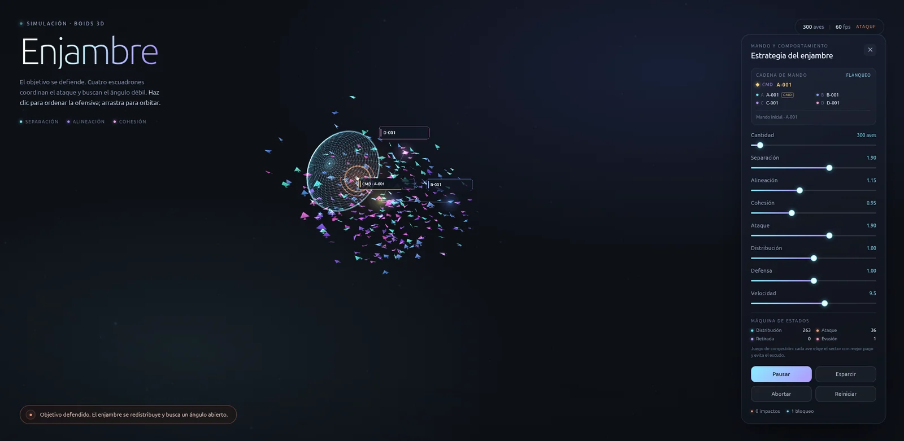
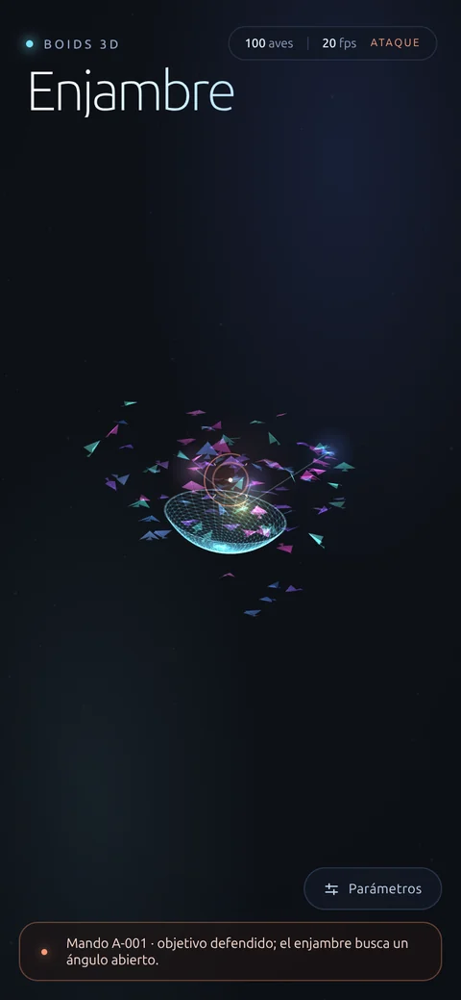

# Enjambre

**Simulación 3D de un enjambre de aves con Boids, objetivo defensivo, teoría de juegos y cadena de mando.**

`Vue 3` · `Three.js` · `WebGL2` · `Vite`



`Enjambre` simula un grupo de aves que ataca un objetivo que se defiende. Las aves vuelan con el algoritmo de Boids, se reparten el ataque mediante un juego de congestión, ejecutan una máquina de estados finitos y obedecen una jerarquía de escuadrones cuyos líderes se reemplazan automáticamente cuando caen.

El objetivo no es solo visual: el escudo persigue al sector más congestionado, los pulsos defensivos derriban líderes y el enjambre debe redistribuirse para encontrar un ángulo abierto.

## Tabla de contenidos

- [Características](#características)
- [Inicio rápido](#inicio-rápido)
- [Uso](#uso)
- [Algoritmos](#algoritmos)
  - [Boids en 3D](#1-boids-en-3d)
  - [Rejilla espacial](#2-rejilla-espacial)
  - [Defensa del objetivo](#3-defensa-del-objetivo)
  - [Teoría de juegos](#4-teoría-de-juegos)
  - [Máquina de estados finitos](#5-máquina-de-estados-finitos)
  - [Cadena de mando y relevos](#6-cadena-de-mando-y-relevos)
  - [Renderizado WebGL](#7-renderizado-webgl)
- [Arquitectura](#arquitectura)
- [Flujo de un frame](#flujo-de-un-frame)
- [Parámetros](#parámetros)
- [Rendimiento y potencia de cómputo](#rendimiento-y-potencia-de-cómputo)
- [Depuración](#depuración)
- [Limitaciones y próximos pasos](#limitaciones-y-próximos-pasos)
- [Tecnologías](#tecnologías)
- [Créditos](#créditos)

## Características

- **Boids 3D**: separación, alineación y cohesión calculadas en un volumen tridimensional.
- **Hasta 5000 aves**: deslizador de 50 a 5000; la simulación usa una rejilla espacial para evitar comparar todos contra todos.
- **Objetivo defensivo**:
  - Escudo direccional adaptativo que persigue al sector con más aves.
  - Pulsos radiales periódicos que repelen y derriban líderes.
  - Repliegue preventivo cuando el pulso está cargando.
- **Teoría de juegos**: 18 sectores alrededor del objetivo; cada ave elige su mejor respuesta en un juego de congestión que castiga la aglomeración y el riesgo del escudo.
- **FSM por ave**: distribución, espera, ataque, retirada y evasión.
- **Cadena de mando**:
  - Código único por ave (`A-001`, `B-014`, `C-023`…).
  - Cuatro escuadrones, un líder por escuadrón y un comandante.
  - Los líderes acuerdan un flanco distinto para cada escuadrón.
  - Si un líder cae, **el siguiente código de su escuadrón asume el mando**; la jerarquía nunca se rompe.
- **Visualización de mando**: etiquetas 3D con códigos, halos de líder y líneas de comunicación.
- **WebGL con instancing**: todas las aves se dibujan en una sola llamada de render; el aleteo y la orientación se calculan en el vertex shader.
- **Cámara orbital**: arrastra para rotar y usa la rueda o el pellizco para acercar.
- **Interfaz reactiva** con panel de parámetros, contadores de impactos/bloqueos, estados de la FSM y registro de ascensos.

## Inicio rápido

### Requisitos

- Node.js 22 o superior. Probado con Node.js 24.19 y npm 11.17.
- Un navegador con WebGL2 habilitado. Se recomienda aceleración por hardware.

### Instalar y ejecutar

```bash
npm install
npm run dev
```

Abre la URL que muestra Vite, normalmente `http://localhost:5173`.

### Producción

```bash
npm run build
npm run preview
```

El resultado queda en `dist/`.

### Scripts

| Comando | Descripción |
| --- | --- |
| `npm run dev` | Servidor de desarrollo con recarga en caliente |
| `npm run build` | Compila la versión de producción |
| `npm run preview` | Sirve localmente la compilación de producción |
| `npm test` | Tests unitarios de la simulación con `node --test` |

### Tests

```bash
npm test
```

Cubren los códigos y la cadena de mando, los relevos, la instantánea de líderes del pulso, las transiciones de la FSM, los impactos y la rejilla espacial. La simulación acepta `seed` o `rng` en el constructor para que las pruebas sean deterministas.

## Uso

### Interacción

| Acción | Resultado |
| --- | --- |
| Clic o toque | Fija el objetivo defendido y ordena la ofensiva |
| Arrastrar | Orbita la cámara |
| Rueda o pellizco | Zoom |
| Botón **Parámetros** | Abre o cierra el panel |
| **Pausar** | Congela el movimiento de las aves |
| **Esparcir** | Dispersa el enjambre y reinicia la distribución |
| **Abortar** | Elimina el objetivo actual |
| **Reiniciar** | Reinicia aves, estados y jerarquía |

Al hacer clic se lanza un rayo desde la cámara contra un plano que pasa por el origen y mira hacia la cámara. El punto de impacto se limita al volumen de simulación y se convierte en el objetivo.

### El panel

- **Cadena de mando**: comandante, líderes de escuadrón, códigos, estrategia actual (flanqueo o repliegue) y último ascenso.
- **Máquina de estados**: número de aves en distribución, ataque, retirada y evasión.
- **Parámetros**: cantidad y comportamiento.
- **Impactos y bloqueos**: efectividad del ataque y del escudo.

### Parámetros

| Control | Rango | Por defecto | Efecto |
| --- | ---: | ---: | --- |
| Cantidad | 50–5000 | 100 | Número de aves |
| Separación | 0–3 | 1.90 | Fuerza para no chocar entre sí |
| Alineación | 0–3 | 1.15 | Tendencia a igualar la dirección de las vecinas |
| Cohesión | 0–3 | 0.95 | Atracción hacia el centro del grupo |
| Ataque | 0–3 | 1.90 | Intensidad de la pasada hacia el objetivo |
| Distribución | 0–2 | 1.00 | Peso de la congestión en el juego de sectores |
| Defensa | 0–2 | 1.00 | Intensidad del escudo y de los pulsos |
| Velocidad | 3–14 | 9.5 | Velocidad máxima de las aves |

Con `Distribución = 0` las aves tienden a amontonarse; con valores altos se reparten mejor. Con `Defensa = 0` el escudo y los pulsos se desactivan.

### Móvil



La cámara se aleja automáticamente en pantallas estrechas para que quepa el enjambre. Las etiquetas 3D de los líderes se ocultan para no tapar la escena; el código del comandante se muestra en la pista inferior y la cadena completa está en el panel.

## Algoritmos

### 1. Boids en 3D

Cada ave es un agente con posición y velocidad en tres dimensiones. En cada paso acumula tres fuerzas clásicas de Craig Reynolds:

```text
Separación: alejarse de las vecinas demasiado próximas.
Alineación: orientar la velocidad hacia la media de las vecinas.
Cohesión:  acercarse a la posición media del vecindario.
```

La fuerza de dirección se calcula así:

```text
deseado = normalizar(dirección) * velocidadMáxima
fuerza  = deseado - velocidad
fuerza  = limitar(fuerza, fuerzaMáxima)
```

Cada fuerza se multiplica por su peso y se suman. El resultado se limita de nuevo a `maxForce`, se integra con `velocidad += fuerza * dt` y se aplica un límite de velocidad mínima y máxima. La posición avanza con `posición += velocidad * dt`.

Durante el ataque la cohesión baja (a `0.5×` y a `0.2×` en pleno ataque) para que el grupo se abra y las pasadas sean individuales. Los bordes usan una fuerza suave de retorno y un envolvente de seguridad para que ninguna ave se pierda.

Constantes principales:

```text
percepción         7.4
radioSeparación    3.2
maxSpeed           9.5
minSpeed           3.2
maxForce          16
margenBordes      10
```

### 2. Rejilla espacial

Comparar cada ave con las demás sería O(n²). En su lugar se construye cada fotograma una rejilla uniforme cuyo lado es el radio de percepción:

1. Se cuenta cuántas aves hay en cada celda.
2. Se calculan prefijos para obtener el inicio de cada celda.
3. Se colocan los índices en un array plano (`counting sort`).
4. Cada ave revisa únicamente sus 27 celdas vecinas (3×3×3).

El coste es O(n + celdas + n·k), donde `k` es el número de vecinas reales. La rejilla elimina la comparación global, aunque en un racimo muy denso `k` crece y el coste por ave aumenta.

### 3. Defensa del objetivo

El objetivo mantiene un **escudo direccional**:

- Cada 0.22 s se recalculan los sectores ocupados.
- El escudo apunta al sector con más aves: la defensa es adaptativa.
- Su dirección se interpola suavemente: `k = 1 - e^(-2.2·dt)`.
- Tiene un cono de cobertura de `0.95 rad` (~54°) y un radio de 9.5 unidades.

Una pasada se bloquea si el ave está dentro del radio y su dirección desde el objetivo cae dentro del cono:

```text
dot(direcciónAve, direcciónEscudo) > cos(0.95)
```

El ave bloqueada entra en `EVASIÓN`, recibe un impulso hacia afuera y no suma impacto.

Además, el objetivo libera un **pulso radial** cada 5–7 segundos:

- Radio de 15 unidades.
- Las aves alcanzadas reciben un impulso y pasan a `EVASIÓN`.
- Los líderes alcanzados son derribados.
- Los líderes que pueden caer se fijan al inicio del pulso. Así, un reemplazo promovido durante el mismo pulso queda a salvo y no se produce una cadena de derribos.

El objetivo empieza a brillar ~2.2 s antes del pulso. En el último ~1 s (cuando la carga supera `RETREAT_CHARGE = 0.55`), la estrategia cambia a **repliegue**: las aves que están atacando y se encuentran dentro del radio de peligro se retiran antes de la onda.


### 4. Teoría de juegos

El reparto se modela como un **juego de congestión** con 18 sectores repartidos por la esfera mediante una espiral de Fibonacci. Cada ave es un jugador que elige un sector; el pago depende de cuántas aves eligen el mismo sector y del riesgo defensivo.

El pago que usa cada ave es, de forma aproximada:

```text
U(s) = -distribución · congestión(s)
       -defensa · 3.2 · riesgoEscudo(s)²
       -0.22 · costeDesplazamiento(s)
       +0.55 · alineaciónConElFlancoDelEscuadrón(s)
       +0.20 · [s == sectorOrdenado]
       +0.30 · [s == sectorActual]
       +ruido(±0.11)
```

Donde:

- `congestión(s) = avesEnSector(s) / mediaPorSector`.
- `riesgoEscudo(s)²` crece cuando el sector cae dentro del cono del escudo.
- `costeDesplazamiento(s) = 1 - dot(direcciónAve, direcciónSector)`.
- El término de inercia y el ruido evitan oscilaciones y permiten explorar.

Cada ave actualiza su mejor respuesta de forma **escalonada** (temporizadores de 1–2.5 s), con un umbral de histéresis de `0.12`. Solo se replantea el sector cuando está en `DISTRIBUCIÓN` o `ESPERA`. Al cambiar de sector se ajustan los contadores de ocupación de forma incremental.

Los **líderes** añaden una capa de coordinación: cada 2.4–3.2 s asignan un sector distinto a cada escuadrón. El escuadrón del comandante elige primero; el resto elige entre los sectores libres con una puntuación que evita el escudo y la congestión:

```text
score(s) = -4.5 · riesgoEscudo(s)²
           -0.35 · (1 + distribución) · congestión(s)
           +ruido
```

El resultado no es un equilibrio perfecto, pero sí una aproximación estable a un reparto tipo Nash: las aves evitan el escudo y se separan cuando un sector se satura.

### 5. Máquina de estados finitos

Cada ave tiene un estado y un temporizador:

```text
DISTRIBUCIÓN ──► ESPERA ──► ATAQUE ──► RETIRADA
      ▲             │           │
      │             └───────────┴──► EVASIÓN
      └────────────────────────────────┘
```

| Estado | Comportamiento | Salida |
| --- | --- | --- |
| `DISTRIBUCIÓN` | Vuela al punto de espera de su sector | Cerca del punto (< 7 u) → `ESPERA` |
| `ESPERA` | Aguarda en la formación | Temporizador de 0.15–0.5 s → `ATAQUE` |
| `ATAQUE` | Se lanza en línea recta al objetivo | Impacto, bloqueo o repliegue |
| `RETIRADA` | Sale en curva tras impactar | Temporizador → `DISTRIBUCIÓN` |
| `EVASIÓN` | Se aleja tras un pulso o bloqueo | Temporizador → `DISTRIBUCIÓN` |

Detalles del ataque:

- Si la distancia al objetivo es menor que `strikeRadius = 2.6`, se registra un impacto y pasa a `RETIRADA`.
- Si entra en el cono del escudo, pasa a `EVASIÓN` y el escudo suma un bloqueo.
- Si el pulso está cargando y está dentro del radio de peligro, se retira antes de la onda.
- Los líderes derribados permanecen en `EVASIÓN` durante su tiempo de recuperación.

Los contadores de estado se actualizan dos veces por segundo y se muestran en el panel.

### 6. Cadena de mando y relevos

Cada ave recibe un código estable a partir de su índice:

```text
escuadrón = índice % 4
rango     = floor(índice / 4) + 1
código    = letra(escuadrón) + "-" + rango
```

Ejemplos: `A-001`, `B-014`, `C-023`, `D-1250`.

La jerarquía se define así:

- **Líder de escuadrón**: inicialmente el código activo más bajo; tras un relevo, el siguiente código activo del escuadrón.
- **Comandante**: el líder de escuadrón con el índice más bajo.
- Los líderes comparten la estrategia de flancos descrita en la sección de teoría de juegos.

Cuando un pulso derriba a un líder:

1. Se marca con un tiempo de recuperación de ~6 s.
2. Su escuadrón busca el **siguiente código activo** dentro del mismo escuadrón.
3. Si no queda ningún código posterior activo, se cierra el círculo con los códigos anteriores.
4. Se recalcula el comandante entre los líderes supervivientes.
5. Si no queda ningún líder, el código activo más antiguo asume el mando global.

```text
líder derribado ──► siguiente código del escuadrón
                  └─ si no hay: círculo al código anterior activo
comandante      ──► líder de escuadrón activo más antiguo
                  └─ si no hay líderes: código activo más antiguo
```

El registro del panel guarda los últimos cuatro eventos, por ejemplo:

```text
A-002 derribada · A-003 asume el escuadrón A
B-003 derribada · B-004 asume el escuadrón B
B-001 toma el mando del enjambre
```

Un líder derribado vuelve como miembro al recuperarse. No recupera el mando automáticamente: la responsabilidad ya fue delegada al siguiente código.

La primera versión de esta lógica derribaba a los reemplazos promovidos durante el mismo pulso, lo que producía cascadas de decenas de ascensos. Ahora el pulso toma una **instantánea de los líderes al inicio** y solo puede derribar a esos líderes, no a sus reemplazos.

### 7. Renderizado WebGL

Las aves se dibujan con `InstancedBufferGeometry` y un `ShaderMaterial` propio:

- Un único *draw call* para todas las aves.
- 12 vértices por ave: dos alas, cuerpo y cola.
- Atributos instanciados: posición, velocidad, color y fase.
- El vertex shader construye una base ortonormal a partir de la velocidad (`forward`, `right`, `up`) y orienta el ave.
- El aleteo se calcula con `sin(tiempo + fase)` y desplaza las puntas de las alas.
- El color se asigna por escuadrón (cian, azul, violeta y magenta).
- La mezcla es aditiva; la intensidad baja cuando hay muchas aves superpuestas para no saturar el centro.
- El tamaño se adapta a la cantidad de aves y a la distancia de la cámara.

La escena incluye además:

- Retícula naranja del objetivo.
- Cúpula de escudo y anillo de borde.
- Ondas de pulso (esfera y anillo).
- Chispas de impactos y de líderes derribados.
- Polvo ambiental.
- Etiquetas de códigos, halos de líder y enlaces de mando.

En pantallas estrechas la cámara se encuadra automáticamente; si la relación de aspecto es menor que 0.8 se ocultan las etiquetas de los líderes y se conservan los halos y enlaces.

## Arquitectura

```text
src/
├── App.vue                  Interfaz, panel, cadena de mando y HUD
├── App.css                  Estilos del componente App
├── main.js                  Punto de entrada de Vue
├── style.css                Estilos base
├── composables/
│   └── useBoids.js          RAF, resize, eventos de puntero y puente Vue
└── lib/
    ├── constants.js         Constantes, estados y parámetros por defecto
    ├── palette.js           Colores compartidos por render y HUD
    ├── random.js            PRNG seedable para tests y depuración
    ├── spatialGrid.js       Rejilla espacial (counting sort)
    ├── sectors.js           Sectores y juego de congestión
    ├── commandChain.js      Códigos, líderes, comandante y relevos
    ├── defense.js           Escudo direccional y pulsos
    ├── steering.js          Boids, FSM, integración y bordes
    ├── flock3d.js           Orquestación de la simulación y API pública
    └── birdScene.js         Three.js: instancing, shader, escudo, pulsos,
                             etiquetas, enlaces y cámara
```

Separación de responsabilidades:

- `flock3d.js` orquesta los sistemas y no conoce Vue ni Three.js. `constants.js`, `random.js`, `spatialGrid.js`, `sectors.js`, `commandChain.js`, `defense.js` y `steering.js` son lógica pura sobre arrays tipados.
- `birdScene.js` no conoce la lógica interna del juego: consume una vista de solo lectura (`getRenderState()`), dibuja la escena y consume los eventos de impactos, bloqueos, pulsos y derribos.
- `useBoids.js` conecta ambos con la reactividad de Vue: crea la simulación y la escena, ejecuta el bucle de animación, procesa clics y publica estadísticas.

Flujo de datos:

```text
App.vue ──parámetros/cantidad──► useBoids ──► Flock3D
   ▲                               │             │
   └────estadísticas/mando─────────┘             ▼
                                          BirdScene ──► WebGL
```

## Flujo de un frame

1. `requestAnimationFrame` calcula `dt` (limitado a 50 ms).
2. Si no está en pausa, `Flock3D.update(dt)`:
   - reconstruye la rejilla espacial,
   - actualiza la defensa y los pulsos,
   - actualiza la estrategia de escuadrones,
   - recupera líderes derribados,
   - delega el paso de vuelo en `SteeringSystem` (vecinas, fuerzas, FSM,
     planificación e integración).
3. `BirdScene.update(dt, tiempo)`:
   - actualiza el tamaño y la intensidad adaptativos,
   - sube posiciones y velocidades a la GPU,
   - actualiza marcador, escudo, pulsos, chispas, etiquetas y enlaces,
   - actualiza los controles de cámara.
4. `render()` dibuja la escena.
5. Cada 0.5 s se publican FPS, impactos, bloqueos, estados FSM y cadena de mando a la interfaz.

## Parámetros

### Ajustables desde la interfaz

| Parámetro | Rango | Defecto |
| --- | ---: | ---: |
| Cantidad | 50–5000 | 100 |
| Separación | 0–3 | 1.90 |
| Alineación | 0–3 | 1.15 |
| Cohesión | 0–3 | 0.95 |
| Ataque | 0–3 | 1.90 |
| Distribución | 0–2 | 1.00 |
| Defensa | 0–2 | 1.00 |
| Velocidad | 3–14 | 9.5 |

### Constantes de simulación

Están en `src/lib/constants.js`:

| Constante | Valor | Uso |
| --- | ---: | --- |
| `perception` | 7.4 | Radio de vecindad |
| `separationRadius` | 3.2 | Radio de separación |
| `maxForce` | 16 | Aceleración máxima |
| `edgeMargin` | 10 | Margen de los bordes |
| `strikeRadius` | 2.6 | Radio de impacto |
| `STAGE_RADIUS` | 20 | Radio de la formación de espera |
| `SECTOR_COUNT` | 18 | Sectores del juego |
| `SQUAD_COUNT` | 4 | Escuadrones |
| `SHIELD_RADIUS` | 9.5 | Radio del escudo |
| `SHIELD_ANGLE` | 0.95 rad | Semiangulo del cono del escudo |
| `PULSE_RADIUS` | 15 | Radio del pulso defensivo |
| `RETREAT_CHARGE` | 0.55 | Carga de pulso que activa el repliegue |
| `LEADER_DOWN_TIME` | ~6 s | Recuperación de un líder |
| `STRATEGY_INTERVAL` | ~2.4 s | Reunión de líderes |

## Rendimiento y potencia de cómputo

### Complejidad

| Proceso | Coste |
| --- | --- |
| Rejilla espacial | O(n + celdas) |
| Boids (vecinas) | O(n·k), con `k` vecinas reales |
| FSM | O(n) por paso |
| Juego de sectores | O(n·18) repartido en decisiones escalonadas |
| Jerarquía de líderes | O(4) cada ~2.4 s |
| Renderizado | O(n) vértices + coste de relleno |

### Mediciones

Medido en el entorno de desarrollo (AMD Radeon 890M, Chrome, 1920×937, 24 hilos). Los valores dependen del estado del enjambre y de la densidad del racimo:

| Aves | FPS observados | Simulación aproximada |
| ---: | ---: | ---: |
| 100 | ~60 | ~0.04 ms/paso |
| 1 000 | ~60 | ~1.2 ms/paso |
| 3 000 | ~60 | — |
| 5 000 | ~22 en asedio denso | ~26 ms/paso en Node; hasta ~60 ms en racimos muy densos |

La capa de mando no es el cuello de botella:

- La jerarquía son cuatro escuadrones y se actualiza cada ~2.4 s.
- La FSM es O(1) por ave.
- El juego de sectores solo evalúa 18 opciones cuando a cada ave le toca replantearse el sector.
- En una medición densa a 5000 aves, la coordinación completa añadió aproximadamente **3 ms (~5 %)** frente al Boids base.

Lo que domina el coste es la **búsqueda de vecinas** y el **renderizado**. A 5000 aves en un volumen fijo la densidad es alta: cada ave ve muchas más vecinas y la ventaja de la rejilla se reduce. En pantalla, la mezcla aditiva y el relleno de miles de aves también pesan.

### Cómo escalar más

- Limitar el número de vecinas por ave.
- Aumentar el volumen de simulación o reducir la percepción con la cantidad.
- Bajar la frecuencia de planificación de sectores.
- Usar LOD o sprites a distancia.
- Mover la simulación a un `Web Worker` o a la GPU.
- Reducir la cantidad de aves o la resolución del render.

Para 100–3000 aves la experiencia es fluida en el equipo de prueba. 5000 es el modo de estrés.

## Depuración

En desarrollo, la simulación y la escena quedan expuestas en `window.__boids`:

```js
__boids.simulation.getStateCounts()
// [distribución, espera, ataque, retirada, evasión]

__boids.simulation.getCommandInfo()
// comandante, líderes, estrategia y registro

__boids.simulation.getCode(42)
// "C-011"

__boids.simulation.leaderOfSquad
__boids.simulation.commander
__boids.simulation.downTimers
__boids.scene.totalImpacts
__boids.scene.totalBlocks
```

`setCount()` también está disponible en la simulación, pero si se usa directamente no se sincroniza el deslizador de Vue; para probar desde la interfaz es mejor usar el control de cantidad.

El hook solo existe con `import.meta.env.DEV`; no se publica en la compilación de producción.

## Limitaciones y próximos pasos

- El objetivo no tiene puntos de vida: el escudo y los pulsos son infinitos.
- Los líderes derribados se recuperan como miembros; no se eliminan permanentemente.
- La comunicación entre líderes es una simulación local por ticks de estrategia, no una red real.
- No hay colisiones físicas ni mallas de colisión; las aves son geometría instanciada.
- Los cuatro escuadrones y los 18 sectores están fijados en el código, aunque son fáciles de cambiar.
- A 5000 aves el rendimiento cae en hardware integrado.

Posibles extensiones:

- Vida y destrucción del objetivo.
- Comunicación con latencia y pérdida de paquetes.
- Diferentes doctrinas de ataque por escuadrón.
- Más tipos de defensa (torretas, campos de minas, escudos móviles).
- Exportar métricas de la simulación.
- Ejecutar la simulación en un worker para liberar el hilo principal.

## Tecnologías

- [Vue 3](https://vuejs.org/) — interfaz y reactividad.
- [Three.js](https://threejs.org/) — escena, cámara, instancing y shaders WebGL.
- [Vite](https://vite.dev/) — desarrollo y compilación.
- JavaScript moderno con `Float32Array`, `Uint8Array` y `Int32Array`.
- GLSL para el shader de las aves.
- `CanvasTexture` para las etiquetas de códigos.

No se usan texturas ni modelos externos: el ave, el polvo, el escudo, los pulsos y las etiquetas se generan por código.

## Créditos

- Algoritmo de Boids original: **Craig W. Reynolds**, *Flocks, Herds, and Schools: A Distributed Behavioral Model* (1986).
- Three.js y Vue.js por sus respectivas comunidades.
- Diseño y código de esta simulación: proyecto **Enjambre**.

## Licencia

Este repositorio no incluye una licencia explícita. Si vas a reutilizar el código, añade la licencia que corresponda.
